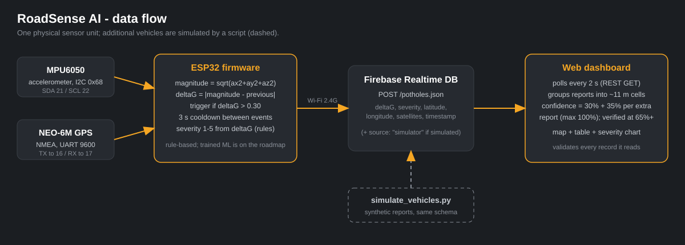
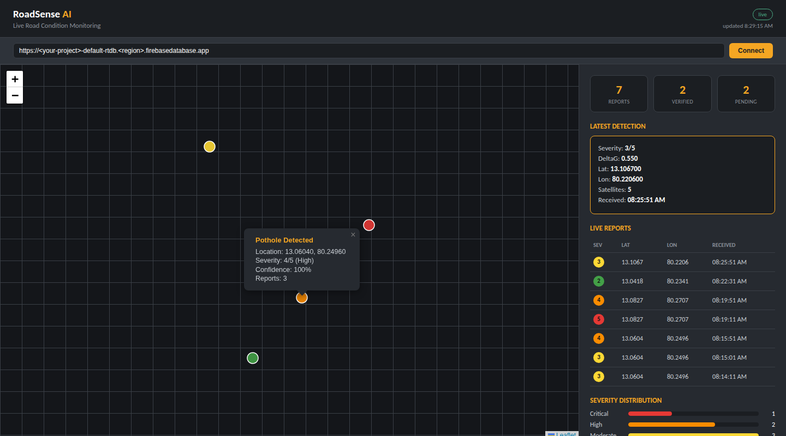

# RoadSense AI

**Low-cost, vehicle-mounted pothole detection: an ESP32 with an accelerometer and GPS reports road shocks to the cloud, and a live dashboard turns agreeing reports into a verified, severity-ranked repair map.**

Built for **TECHNOVA 2026** (shortlisted from campus prelims to the Chennai Zonal Round) and continued afterwards as an open learning project.

> **Read this first - what this is and is not.** This is a working *prototype* of the full pipeline
> (sensor -> detection -> cloud -> live map). Detection is a **tuned threshold, not a trained model**; it has
> **not** been evaluated on real roads; and "multi-vehicle verification" is demonstrated with **one** physical
> unit plus a simulator script. The sections below say exactly what is real.

## Status at a glance

| Piece | Status |
|---|---|
| ESP32 + MPU6050 + NEO-6M sensing | Working prototype (GPS lock with 5-8 satellites, live accelerometer) |
| Shock detection + severity (1-5) | Working, **rule-based**; threshold hand-tuned from bench tests, not validated |
| Upload to Firebase Realtime DB | Working (verified HTTP 200 from the device) |
| Live dashboard (map, table, stats, chart) | Working |
| Multi-vehicle confidence scoring | Logic works; shown with **simulated** extra vehicles |
| Trained ML classifier | Not started (planned) |
| On-road testing, precision/recall | Not done |
| Weatherproof enclosure, vehicle install | Design only |

## The idea

Roads are inspected rarely and complaints are unreliable. If ordinary vehicles carry a cheap sensor, every
drive becomes an inspection. One noisy report cannot be trusted (manhole covers, speed breakers), so a pothole
is only treated as **verified** once several reports agree on the same spot.

## How it works



1. **ESP32** reads the MPU6050 and computes `deltaG`, the change in acceleration magnitude between samples.
2. If `deltaG > 0.30` (3 s cooldown) it tags the event with the GPS position, assigns a severity 1-5 and `POST`s JSON to Firebase.
3. The **dashboard** polls the database every 2 s, groups reports into ~11 m cells, and scores confidence:
   30 % for one report, +35 % for each additional one (max 100 %); **verified at 65 %+**.

Details, formulas and limitations: [`docs/ARCHITECTURE.md`](docs/ARCHITECTURE.md).

## Dashboard



*The screenshot uses **synthetic demo data** (generic Chennai-area coordinates), not real detections.*
Map tiles are optional; without a key the map shows a plain grid and markers still plot at their true coordinates.

## Quick start

You need: ESP32 dev board, MPU6050, NEO-6M GPS, jumper wires, Arduino IDE (ESP32 board support + the
**TinyGPSPlus** library), a free Firebase project, Python 3 for the simulator.

1. **Wire it** - see [`docs/HARDWARE.md`](docs/HARDWARE.md) (SDA 21, SCL 22; GPS TX to 16, RX to 17).
2. **Firebase** - create a Realtime Database and publish the rules in [`firebase/`](firebase/README.md).
   (Test-mode rules **expire after 30 days**.)
3. **Firmware** - in `firmware/roadsense_firmware/` copy `secrets.example.h` to `secrets.h`, fill in your WiFi
   (2.4 GHz only) and the full regional database URL ending in `/potholes.json`, then upload with board
   *ESP32 Dev Module*. Serial Monitor at 115200 baud should show `Firebase Response: 200` after you jolt the unit.
4. **Dashboard** - open `dashboard/index.html` in a browser and paste your database URL (or open
   `index.html?db=https://<project>-default-rtdb.<region>.firebasedatabase.app`).
   Optional: add `&carto_key=<key>` for street tiles.
5. **Simulate extra vehicles** (optional):
   ```bash
   pip install -r tools/requirements.txt
   export ROADSENSE_DB_URL=https://<project>-default-rtdb.<region>.firebasedatabase.app
   python tools/simulate_vehicles.py --lat <lat> --lon <lon> --severity 3
   ```
   Use the coordinates of a pothole your device reported; confidence climbs 30 -> 65 -> 100 %.
   These records are tagged `"source": "simulator"`.

Something not working? [`docs/TROUBLESHOOTING.md`](docs/TROUBLESHOOTING.md) lists every problem we hit and the fix.

## Repository layout

```
firmware/roadsense_firmware/   ESP32 sketch (+ secrets.example.h)
dashboard/index.html           single-file live dashboard (no build, no SDK)
tools/simulate_vehicles.py     synthetic extra-vehicle reports
firebase/                      security rules + setup notes
docs/                          architecture, hardware, experiments, troubleshooting, FAQ
presentation/                  the TECHNOVA 2026 zonal-round deck (PDF)
```

## Documentation

| Doc | What is in it |
|---|---|
| [ARCHITECTURE](docs/ARCHITECTURE.md) | detection rule, schema, confidence maths, design trade-offs, limitations, roadmap |
| [HARDWARE](docs/HARDWARE.md) | wiring, bill of materials and cost, mounting notes |
| [EXPERIMENTS](docs/EXPERIMENTS.md) | what was measured, how the threshold was chosen, what has not been tested |
| [TROUBLESHOOTING](docs/TROUBLESHOOTING.md) | build log of real problems and fixes |
| [FAQ](docs/FAQ.md) | the jury's questions with honest answers |

## Security and privacy

* **Never commit** `secrets.h`, WiFi passwords, API keys or your database URL if the database is open. They are git-ignored; the dashboard takes the URL at runtime.
* The demo database rules are intentionally permissive (public read, validated create-only writes). Fine for a throwaway project, **not** for real use - see [`firebase/README.md`](firebase/README.md).
* **GPS traces are personal data.** Do not publish screenshots, logs or coordinates from your home, college or daily routes. All coordinates in this repo are synthetic.

## Related work

The core idea is not new: accelerometer-based road-quality sensing was studied in Microsoft Research India's
*Nericell* (SenSys 2008) and MIT's *Pothole Patrol* (MobiSys 2008). What this project adds is a small,
low-cost, end-to-end implementation with a report-agreement (confidence) layer and a live priority dashboard -
whose benefit is **not yet measured**.

## Roadmap

Highest priority: collect labelled on-road data, measure the threshold's precision/recall, then try a trained
classifier against it; add device ids and authenticated uploads; replace grid grouping with distance-based
clustering. Full list in [`docs/ARCHITECTURE.md`](docs/ARCHITECTURE.md#7-roadmap).

## TECHNOVA 2026 deck

[`presentation/TECHNOVA_2026_zonal_round.pdf`](presentation/TECHNOVA_2026_zonal_round.pdf) is the deck prepared for the
zonal round (footer branding corrected). It describes the planned system at design stage, including
ML components that are **not** implemented - this README is the source of truth for current status.

## Team

Built by **Team VisionQuest**, St. Joseph's College of Engineering, Chennai:
Vishnu Vardhan E, Sherlin Jeri S, Swetha R, Shivram B, Vijayaganesh S.
Faculty mentor: Dr. P. Elaveni. Repository maintained by Vishnu Vardhan E.

## License

MIT - see [LICENSE](LICENSE).
